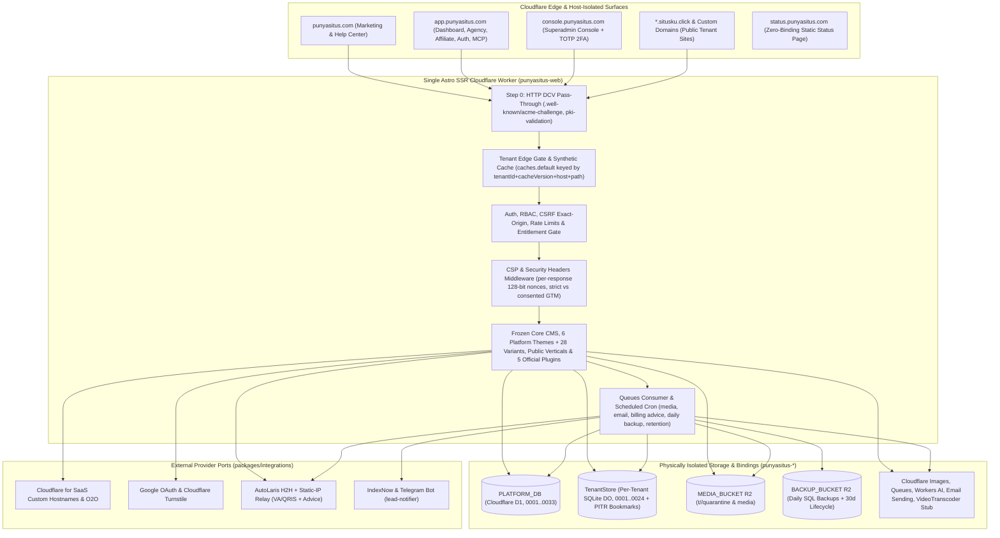

# Architecture — punyasitus

Updated: 2026-11-25
Current state: **M1 + M2 Production Release Candidate (`109 / 110` roadmap tasks complete across Wave 0–Wave 8: `85 / 85` M1 + `22 / 22` Wave 7 M2 + `2 / 2` Wave 8 security & production release gates; `TASK-062` explicitly deferred to Release 1.1 per `DEC-035 C16`).** All `6 / 6` tracked security findings (`SEC-001`..`SEC-006`) and all `8 / 8` integration polish items (`M1-FU-01`..`M1-FU-08`) are `RESOLVED_VERIFIED` (`0` `FINDING_REOPEN_REQUIRED` rows in OWASP ASVS 5.0 L2), and all **`4 / 4` hosted GitHub Actions workflows** are GREEN on `origin/main` (`6ac451f`). Live Cloudflare deployment, external provider onboarding, and Indonesian legal/regulatory approvals remain explicitly gated under `EXT-01`..`EXT-10` (`UNVERIFIED — REQUIRES EXTERNAL AUTHORIZATION`).

## System Map (High-Level Topology & Request Flow)



## Surface, Route & Contract Map (`docs/security/surface-inventory.json`)

| Surface / Host | Route Categories & Counts (`375` Total Routes) | Auth & Isolation Boundary |
|---|---|---|
| **Public Tenant Sites** (`*.situsku.click` & verified custom domains) | `26` public tenant routes (`/`, `/[...slug]`, `/blog/*`, `/layanan/*`, `/produk/*`, `/tour/*`, `/kendaraan/*`, `/gerai`, `/link`, `/sitemap.xml`, `/sitemaps/*.xml`, `/robots.txt`, `/blog/feed.xml`) + `3` host-scoped public APIs (`/api/leads`, `/api/events`, `/api/abuse-report`) | Verified `Host` lookup in `PLATFORM_DB` only (never `X-Forwarded-Host`/`X-Tenant-ID`); host-only `__Host-ps_consent` cookie; `503 no-store` on `suspended`/`recovery` even with warm cache; strict nonced CSP. |
| **Tenant, Agency & Affiliate App** (`app.punyasitus.com`) | `57` dashboard pages + `141` tenant APIs (`/api/tenants/[tenantId]/*`) + `5` agency pages + `16` agency APIs + `1` affiliate page + `3` affiliate APIs + `15` auth/account routes + `6` onboarding APIs + `8` MCP/OAuth routes (`/mcp`, `/oauth2/*`) | Host-isolated `__Host-` session cookie + live `PLATFORM_DB` membership RBAC (strict neutral `404` for foreign tenants) + central exact-`Origin` CSRF + mandatory 2FA for agency admins; `/mcp` is Bearer-only OAuth 2.1 (`16` allowed tools, `31` excluded). |
| **Superadmin Console** (`console.punyasitus.com`) | `21` console pages + `54` console APIs (`/api/console/*`) | Distinct `__Host-` console cookie & signing secret + Google allowlist + active `platform_operators` grant + mandatory TOTP 2FA + 10-minute recent step-up on sensitive actions & CSV exports. |
| **Marketing & Platform Endpoints** (`punyasitus.com` / shared) | `10` public marketing & Help Center routes (`/marketing/*`, `/bantuan/*`) + `8` platform public endpoints (`/api/health/*`, `/api/webhooks/email/bounce`, `/pay/renew`, etc.) + `1` plugin webhook (`/api/plugins/[pluginId]/webhook`) | Signed webhook / HMAC verification before body/DB reads; dotfile & traversal rejection; static status page isolated in `apps/status` with zero bindings. |
| **Machine-Readable Contracts** | **OpenAPI 3.1.1 (`docs/api/openapi.json`):** `258` documented paths (**100% parity** with all `225` shipped `/api/**` + `/mcp` routes, enforced by `tests/task-024/unit.test.ts`). **Plugins:** `5` official Frozen-Core plugins (`seo-ai-autopilot` default-active only; `bio-links`, `wa-cs-rotator`, `wp-importer`, `lead-notifier`). | Zero drift verified in CI (`enumerate-surfaces.mjs --check`, `tests/task-024/unit.test.ts`, `tests/task-078/unit.test.ts`). |

## Pinned Workspace & Runtime Versions (`TASK-023`)

| Layer | Pinned Package / Tool | Version | Notes |
|---|---|---|---|
| Package manager / runtime | `pnpm` / Node.js | `pnpm@12.21.0` / `node >=22.23.4` (CI Node 24) | `allowBuilds: { esbuild: true, workerd: true }` in `pnpm-workspace.yaml` |
| Web SSR & Worker adapter | `astro` / `@astrojs/cloudflare` / `@astrojs/react` | `7.4.13` / `14.4.9` / `7.1.9` | `output: "server"`, `session: false`, `nodejs_compat`, custom Worker entry `apps/web/src/worker/index.ts` |
| Cloudflare CLI & types | `wrangler` / `@cloudflare/workers-types` | `4.166.0` / `5.20261121.1` | `compatibility_date: "2026-11-22"`, `workers_dev: false`, `preview_urls: false` |
| Database ORM & migrations | `drizzle-orm` / `drizzle-kit` | `0.45.4` / `0.31.11` | `PLATFORM_DB` D1 (`0001..0033`, 25 SQL files) + per-tenant `TenantStore` SQLite Durable Object RPC adapter (`0001..0024`, 20 SQL files) |
| Authentication | `better-auth` | `1.7.27` | Per-request `drizzleAdapter(..., { provider: "sqlite" })`, `joins: true`, `cf-connecting-ip`, Google OAuth primary, TOTP 2FA, Organization RBAC, MCP OAuth 2.1 |
| UI foundation | `react` / `@base-ui/react` / `tailwindcss` / `lucide-react` | `19.3.1` / `1.9.0` / `4.3.5` / `1.77.0` | `shadcn/ui` v4 `base-nova` preset; lint & release gates enforce zero `@radix-ui/*`, `asChild`, or `Sparkles` (`DEC-036`) |
| Core utilities | `zod` / `pdf-lib` | `4.6.7` / `1.17.1` | Runtime-neutral validation, OpenAPI 3.1.1 generation, HTML/URL sanitization, Schema.org JSON-LD, and pure-JS receipt PDFs in `workerd` |
| TypeScript & checks | `typescript` / `@astrojs/check` / `eslint` / `vitest` / `@cloudflare/vitest-plugin` | `6.0.3` / `0.9.12` / `10.15.0` / `4.1.12` / `1.9.0` | `strict: true`, `noUncheckedIndexedAccess: true`; Playwright `playwright-core` multi-browser QA (`chromium`, `firefox`, `webkit`) |

## Workspace Layout

```text
apps/
  web/                     @punyasitus/web — single Astro SSR Cloudflare Worker (`punyasitus-web`)
    astro.config.mjs       output: "server", session: false, @astrojs/cloudflare, React, Tailwind v4
    wrangler.jsonc         Cloudflare bindings (PLATFORM_DB D1, TenantStore DO, MEDIA/BACKUP R2, Images, Queue, AI, Email, Cron, VideoTranscoder stub)
    public/_headers        Static asset security headers (`/_astro/*` `X-Content-Type-Options: nosniff`)
    src/worker/            Worker entry (Step 0 HTTP DCV pass-through, fetch/queue/scheduled), TenantStore DO, durable job consumer
    src/middleware/        Host/surface routing, auth/CSRF/session guard, strict/GTM-nonce CSP & baseline security headers, affiliate referral
    src/core/              Tenant edge gate & cache, public route resolvers, section registry, theme registry (6 themes + 28 variants + custom themes), Frozen-Core plugin registry & runtime
    src/themes/            6 platform themes (`compro`, `sales`, `travel`, `catalog`, `resto`, `dealer`) + shared `default/Layout.astro` (`<AnalyticsHead />`, `<Consent />`), `SectionRenderer.astro` (`SectionContactForm`, `SectionCustomForm`), and `custom/sample-agency/Layout.astro` (`managedHead` parity)
    src/pages/             Four host-isolated surfaces:
                           - Marketing (`punyasitus.com`: `/marketing/*`, `/bantuan/*`)
                           - Tenant/Agency/Affiliate App (`app.punyasitus.com`: `/dashboard/[handle]/*`, `/agency/*`, `/affiliate/*`, `/account/*`, `/auth/*`, `/mcp/*`)
                           - Operator Console (`console.punyasitus.com`: `/console/*`)
                           - Public Tenant Sites (`*.situsku.click` & custom domains: `/`, `/[...slug]`, `/blog/*`, `/layanan/*`, `/produk/*`, `/tour/*`, `/kendaraan/*`, `/gerai`, `/link`, `/sitemap.xml`, `/sitemaps/*.xml`, `/robots.txt`, `/blog/feed.xml`, `/api/leads`, `/api/events`, `/api/abuse-report`)
  status/                  Standalone zero-binding static status page (`apps/status/dist/index.html`, `status.json`)
packages/
  core/                    @punyasitus/core — host/surface classification, Zod contracts & OpenAPI 3.1.1 assembler (`schemas/registry.ts`, `schemas/extensions.ts`), catalog/vertical schemas, Schema.org JSON-LD, OG/SEO metadata, media safety, WA dispatcher, consent/CSP builders, pdf-lib receipts, telemetry, Frozen-Core plugin manifest SDK
  db/                      @punyasitus/db — Drizzle schemas, additive SQL migrations (`platform/ 0001..0033` + `ALL_PLATFORM_MIGRATIONS`, `tenant/ 0001..0024` + `ALL_TENANT_MIGRATIONS`), `TenantStore` SQLite DO RPC adapter & PITR bookmark orchestrator, CMS/catalog/outlets/revisions/insights/billing/agency/affiliate/MCP/privacy/tombstone modules
  auth/                    @punyasitus/auth — per-request Better Auth SQLite factory, RBAC & neutral 404 non-member guards, TOTP 2FA step-up, `DEC-045` idle/absolute session ceilings, Agency & Console auth guards
  integrations/            @punyasitus/integrations — server-only external provider ports (Cloudflare Email Sending, Cloudflare SaaS Custom Hostnames, Cloudflare Images/AI, AutoLaris H2H + Advice reconciliation, IndexNow)
  plugins/                 @punyasitus/plugins — 5 official Frozen-Core first-party plugins (`seo-ai-autopilot` default-active only; `bio-links`, `wa-cs-rotator`, `wp-importer`, `lead-notifier`), zero dynamic loading, `plg_<id>__*` table prefix isolation
scripts/
  dev/                     `heavy.sh` (per-worktree lock wrapper), lint, Wrangler dry-run budget check, dev server probe
  backup-restore/          Daily logical SQL `PLATFORM_DB` exporter (`platform-backup.ts`) & isolated restore drill + `DEC-022` tombstone replay (`restore-drill.ts`)
  security/                Surface enumerator (`375` routes, `16` MCP tools, `5` plugins), local built-Worker HTTP DAST & 50-endpoint BOLA suite, OWASP ZAP baseline ruleset (`zap-rules.tsv`)
  verify/                  Topology/route check (`routes.mjs`), M1 checkpoint gate (`m1-gate.mjs`), M1+M2 release gate (`release-gate.mjs`), isolated backup/restore & tombstone drill (`backup-restore-drill.mjs`)
docs/
  api/                     OpenAPI 3.1.1 contract (`openapi.json`, 258 paths) + per-domain API companion references
  operations/              Runbooks (`release-checklist.md`, `release.md`, `backup-restore.md`, `hosting.md`, `privacy.md`, `seo-launch.md`, `telemetry-release.md`, `billing.md`, `email.md`, `mcp.md`, `platform-access.md`, `trust-positif.md`)
  security/                `TASK-078` assurance pack (`asvs-5.0-l2-checklist.md`, `findings-register.md`, `zap-scan-report.md`, `surface-inventory.json`)
tests/
  setup/                   Vitest unit & `@cloudflare/vitest-plugin` `workerd` integration configs
  e2e-gate/                Real built-Worker Playwright multi-viewport, No-JS, negative-case & multi-browser gates (`m1-checkpoint.mjs`, `release-gate.mjs`)
  performance/             Real built-Worker mobile performance budget & PLAN §9 5-run lab (`m1-budget.mjs`, `release-lab.mjs`)
  security/                Exhaustive cross-tenant BOLA unit & `workerd` integration suites (`TASK-078`)
  task-001..task-110/      109 task-scoped verification suites (`TASK-062` deferred to Release 1.1)
.github/workflows/         SHA-pinned hardened workflows (`ci.yml`, `security.yml`, `staged-release-dry-run.yml`, `release-gate.yml`)
```

## Production Architecture Capabilities (M1 + M2)

| Capability | Architecture & Storage | Verification Status |
|---|---|---|
| **Control-Plane Database (`PLATFORM_DB`)** | Cloudflare D1 (`punyasitus-platform`, `apac`, 10 GB) + Drizzle SQLite; **additive migrations `0001..0033`** (`25` SQL files bundled in `ALL_PLATFORM_MIGRATIONS`: tenants, hosts, auth/2FA, billing obligations/receipts/coupons, plugin runtime/store, custom themes, offboarding/exports/tombstones, GTM kill switch, moderation/shared-domain screening, setup service, agency portal, AI writing usage, MCP OAuth 2.1 grants, affiliate program & payout ledger). | Byte-for-byte disk parity + full 25-migration `workerd` apply & idempotency verified (`TASK-001`, `M1-FU-01`); live staging D1 gated (`EXT-01`). |
| **Per-Tenant Database (`TenantStore`)** | Physically isolated SQLite-backed Durable Object per tenant (`locationHint: "apac-se"`, 10 GB/site, `D1Database`-compatible RPC adapter, 30-day PITR bookmarks in `migration_bookmarks`); **additive migrations `0001..0024`** (`20` SQL files bundled in `ALL_TENANT_MIGRATIONS`: pages, posts, typed offerings, media/short-video pipeline, taxonomy archives, structured business profile, starter presets, SEO editor, activity log, custom forms, branches/outlets, analytics event dedup, content screening holds, theme style variants, insights aggregates, content revision history, preferred schedule inquiries). | Physical A-vs-B isolation, full 20-migration `workerd` apply & idempotency (`M1-FU-01`), PITR bookmarks & isolated backup/restore + `DEC-022` tombstone replay verified (`TASK-001`, `TASK-023`, `TASK-037`, `TASK-038`). |
| **Multi-Surface Edge Routing, Sitemaps & Caching** | Four host-isolated surfaces on one Worker (`punyasitus.com`, `app.punyasitus.com`, `console.punyasitus.com`, `*.situsku.click` + verified custom hostnames). Step 0 passes HTTP DCV (`/.well-known/pki-validation/*`, `/.well-known/acme-challenge/*`) straight through. Edge cache (`caches.default`) keyed by `tenantId + cacheVersion + host + path`; suspended/recovery tenants immediately serve `503` `Cache-Control: no-store` `X-Robots-Tag: noindex, nofollow`. Sitemap/robots/RSS fail closed (`503 Retry-After: 60 no-store`) on `TenantStore` outages and emit opted-in taxonomy archives (`M1-FU-05`). | Local built-Worker & `workerd` verified (`TASK-002`, `TASK-017`, `TASK-063`, `TASK-038`); live Cloudflare SaaS DCV & O2O gated (`EXT-02`). |
| **Authentication, RBAC & MCP OAuth 2.1** | Better Auth (`provider: "sqlite"`, `joins: true`), Google OAuth primary + email/password fallback with action-bound Turnstile & honeypot guards, host-isolated `__Host-` cookies, Organization RBAC (`owner`/`admin`/`editor`/`agency_admin`), mandatory Console TOTP 2FA + 10-minute recent step-up, `DEC-045` idle/absolute session ceilings, and Bearer-only tenant **MCP OAuth 2.1** (`16` allowed tools, `31` excluded sensitive tools, PKCE, scoped tokens). | Unit, `workerd` integration & 50-endpoint live HTTP BOLA suite verified (`TASK-025`, `TASK-049`, `TASK-067`, `TASK-075`, `TASK-078`, `TASK-090`); live Google OAuth gated (`EXT-04`). |
| **Themes, Style Variants & Frozen-Core Plugins** | 6 platform themes (`compro`, `sales`, `travel`, `catalog`, `resto`, `dealer`) + 28 style variants + commercial Theme Store & custom agency theme entitlements (`ADR-0010`, `DEC-037`, `managedHead` parity in `sample-agency/Layout.astro` per `M1-FU-04`). Statically registered **5 official Frozen-Core first-party plugins** in `apps/web/src/core/plugin-registry.ts`: `seo-ai-autopilot` (default-active only per `DEC-042`), `bio-links`, `wa-cs-rotator`, `wp-importer`, and `lead-notifier` (zero dynamic `import()`, zero `eval()`, `plg_<id>__*` table isolation). | Verified end-to-end across M1 + M2 (`TASK-018`, `TASK-040`, `TASK-097`..`TASK-102`, `TASK-038`). |
| **M1 + M2 Public Verticals, Analytics, Forms & No-JS Baseline** | Server-rendered HTML-first public pages with full No-JS browsing (`/` homepage, `/blog/*`, `/layanan/*`, `/produk/*`, `/tour/*` Travel & Umrah `DEC-042`, `/kendaraan/*` Vehicle Showroom + static credit-estimate table, `/gerai` Multi-Outlet directory, `/sitemap.xml`, `/robots.txt`), consent-gated `<AnalyticsHead />` + `SectionContactForm`/`SectionCustomForm` wiring (`M1-FU-02`), Schema.org JSON-LD with zero fabricated ratings or financing schema, and `<= 25 KiB` first-party public JS gzip budget. | Built-Worker Playwright multi-browser (`chromium=PASSED, firefox=PASSED, webkit=PASSED`, `54` screenshots, `360/768/1440`), 12-route No-JS crawl with per-route Schema.org `@type` checks, and strict PLAN §9 5-run mobile lab verified locally AND on hosted GitHub Actions (`Production Release Gate` runs `45577200732` / `45581723071`: `LCP p50=460ms / p95=476ms`, **`CLS p50=0 / p95=0 / max=0`, `clsBudgetMet=true`, zero waiver**; `M1-FU-08` resolved in `1da5819`). |
| **Billing, Agency & Affiliate Portals** | AutoLaris H2H payment channels (VA/QRIS), webhook Advice reconciliation, pure-JS `pdf-lib` receipts, coupons, plugin store add-ons, multi-tenant Agency Portal (`TASK-083`), and Affiliate enrollment, attribution, commission ledger, payout batches & console payouts (`TASK-084`..`TASK-086`). | Local `workerd` & UI verified (`SEC-004` 2FA step-up & CSV truncation headers resolved in `5cb5de1`); live AutoLaris merchant relay & legal/tax filings gated (`EXT-06`, `EXT-07`, `EXT-08`). |
| **Backup, Restore & `DEC-022` Tombstone Replay** | Daily `PLATFORM_DB` logical SQL export (`cron.daily_platform_backup`) to private `punyasitus-backup` R2 (30-day lifecycle) + D1/DO 30-day PITR + mandatory `replayDeletionTombstones` (`DEC-022`) preventing deleted tenant resurrection on backup restore. | Standalone Node SQLite restore/checksum drill (`scripts/verify/backup-restore-drill.mjs`) AND real product-code `platform-backup.ts` + `replayDeletionTombstones` `workerd` integration verified locally & on hosted GitHub Actions (`rtoMs=82ms`); live production R2 snapshot gated (`EXT-01`, `EXT-10`). |
| **Security Assurance, OpenAPI Parity & CI Release Gates** | OWASP ASVS 5.0 L2 checklist (`V1..V17`, **`0` `FINDING_REOPEN_REQUIRED`**), `375`-route surface inventory parity, `258`-path OpenAPI 3.1.1 contract (`100%` parity with all `225` shipped `/api/**` + `/mcp` routes, `M1-FU-06`), 50-endpoint live cross-tenant BOLA suite, central HTML/JSON security headers & strict nonced CSP (`0` DAST alerts), OWASP ZAP baseline workflow (`.github/workflows/security.yml`), and multi-browser (`chromium`/`firefox`/`webkit`) strict zero-waiver CI release gate (`.github/workflows/release-gate.yml`). All 4 workflows enforce `permissions: {}`, per-job `contents: read`, `persist-credentials: false`, `timeout-minutes`, 100% 40-char SHA pinning, zero `${{ secrets.* }}`, and zero live deploys. | **`4 / 4` Hosted GitHub Actions Workflows GREEN on `6ac451f` (2026-11-25):** `CI` (`45581722965`), `Security Assurance` (`45581722913`, OWASP ZAP Baseline `PASS: 65, FAIL-NEW: 0, WARN-NEW: 0, IGNORE: 6`), `Staged Release Dry-Run` (`45581722924`), `Production Release Gate (M1 + M2)` (`45581723071`). `SEC-001`..`SEC-006` & `M1-FU-01`..`M1-FU-08` `RESOLVED_VERIFIED`; live staging ZAP full scan & external provider/legal approvals remain gated (`EXT-01`..`EXT-10`). |

## Boundaries & Operational Conventions

- **Strict Tenant Isolation:** Every tenant-owned API enforces session + membership RBAC and returns strict neutral `404` for foreign tenants; `TenantStore` databases are physically partitioned per tenant Durable Object ID.
- **Additive Schema Discipline:** Zero `DROP TABLE`, `DROP COLUMN`, or `TRUNCATE` in migrations; rollbacks use compatible application revisions or maintenance mode (`503`) + verified backup restore with `DEC-022` tombstone replay (`RELEASE.md`).
- **Heavy Local Execution:** `pnpm build`, `pnpm test:integration`, and `pnpm test:e2e` route through `scripts/dev/heavy.sh` (per-worktree `heavy-run` lock on dev hosts, direct execution in CI) with ephemeral free ports (`port: 0`) and isolated temp `.wrangler/state` directories.
- **Cloudflare Account Hygiene:** All resources use the `punyasitus-*` naming prefix on PunyaSitus's dedicated Cloudflare account.

## Verification Gates

- **Spec & DAG Integrity:** `pnpm spec:check` (`python3 scripts/check-spec.py && python3 scripts/test-check-spec.py`)
- **Static & Build:** `pnpm lint`, `pnpm typecheck`, `pnpm build` (Astro SSR build + Wrangler dry-run `< 64 MiB` & `< 1 s` startup), `actionlint .github/workflows/*.yml`
- **Automated Test Suites:** `pnpm test:unit`, `pnpm test:integration` (real `workerd` D1 + `TenantStore` DO + R2 + Queues), `node scripts/security/run-security-suite.mjs`
- **Release Gate & Rehearsals (`TASK-038`):** `node scripts/verify/release-gate.mjs`, `node scripts/verify/backup-restore-drill.mjs --verify-rollback-plan`, `node tests/performance/release-lab.mjs`, `node tests/e2e-gate/release-gate.mjs`, `node tests/task-038/e2e.mjs`, `release-manifest --json .`, and `rollback-check --json --migration-risk M1 .`
